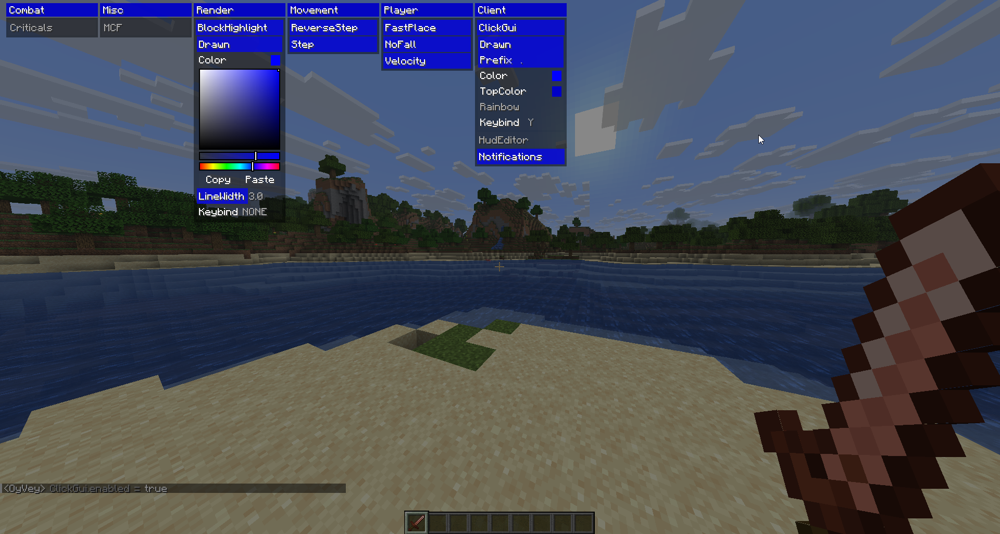

<div align="center">

# oyvey-ported
Kosher client base ported to modern Minecraft by [@cattyngmd](https://github.com/cattyngmd)



# Why


# What
Add stuff to it like you would add stuff to your 1.12.2 OyVey paste

</div>

## PearlCatch (Combat)
Throws a wind charge so it meets **your own** ender pearl that is already in flight. The aim is solved exactly from
vanilla physics (`InterceptSolver`), including the shooter's own momentum (which is what handles diagonal/sprinting
throws), network latency, and wind-charge bursts that will push the pearl. The pearl path is cut off at its predicted
block impact.

**Which pearls.** Only ender pearls whose resolved owner is the local player. Other players' pearls, and pearls whose
owner has not been resolved by the client, are ignored. Ownership is checked again right before the slot change and
right before the use, not just when the pearl is first picked.

**How it interacts.** The throw is sent at the start of the client tick (`PreTickEvent`, before the movement packet),
which is where a vanilla client sends slot-change and use-item packets. The previous hook ran after the movement packet.
- If the wind charge is already in the selected slot or the off hand, no slot packet is sent.
- Otherwise its hotbar slot is selected once (client selection and the slot packet happen together), the charge is
  used, and the previous slot is restored on a later tick, only if you have not changed slot yourself. Never two slot
  changes in one tick, and no swap-and-swap-back.
- Wind charges in the main inventory are not used any more (that needed container clicks with no inventory open).
  Move them to the hotbar or off hand.
- A charge on its use cooldown is detected before anything is sent.
- While a throw is pending (used, but the charge has not shown up yet) nothing else is sent. A throw that is refused
  or never shows up is retried after a short wait, at most 3 interactions per pearl in total.
- Disabling the module, or changing world/dimension/player, drops all pending state and sends nothing.

| Setting | Meaning |
| --- | --- |
| Range / Window | how far to look for pearls / how many ticks ahead to search for an intercept |
| HitRadius | allowed along-track miss in blocks beyond the charge's per-tick sweep |
| Pick | `CLOSEST` (pearl nearest you), `EARLIEST`, or `BEST_FIT` |
| AutoLatency / ExtraTicks | lead = ping/50 ms + ExtraTicks. **Tune ExtraTicks first if shots land early/late** |
| WindBursts / BurstBoost / BurstRadius | model in-flight wind charges that will deflect the pearl; BurstBoost is the knockback scale |
| LineOfSight | skip intercepts whose flight path is blocked by blocks |
| Cooldown | ticks between throws (vanilla wind charge cooldown is 10) |
| Inventory | **deprecated, ignored** (kept so saved configs load) |
| Momentum | `DISPLACEMENT` (default): the shooter's per-tick movement as the server sees it (position minus last tick's position). `VELOCITY`: the client's friction-scaled velocity, kept only to compare in game. **If shots miss while moving, try flipping this first** |
| Silent | restore your rotation right after the throw, in the same tick |
| Debug | log each solution, and why a throw did not happen, through the client logger |

`OwnPearls` was removed: targeting other players' pearls is no longer possible. A leftover `OwnPearls` entry in an
existing `modules.json` is ignored.

Because the throw now happens one phase earlier in the tick, the timing relative to the pearl shifts slightly; if shots
land early or late after updating, re-tune `ExtraTicks`.

Verify the logic without the game (no dependencies):
```
java -m jdk.compiler/com.sun.tools.javac.Main -d out \
  src/main/java/me/alpha432/oyvey/util/prediction/InterceptSolver.java \
  src/test/java/me/alpha432/oyvey/util/prediction/InterceptSolverCheck.java
java -cp out me.alpha432.oyvey.util.prediction.InterceptSolverCheck

java -m jdk.compiler/com.sun.tools.javac.Main -d out2 \
  src/main/java/me/alpha432/oyvey/util/interaction/*.java \
  src/test/java/me/alpha432/oyvey/util/interaction/ThrowSequencerCheck.java
java -cp out2 me.alpha432.oyvey.util.interaction.ThrowSequencerCheck
```
These cover the maths and the sequencing rules against a simulated client/server. They do not test the in-game wiring
or any anti-cheat.
